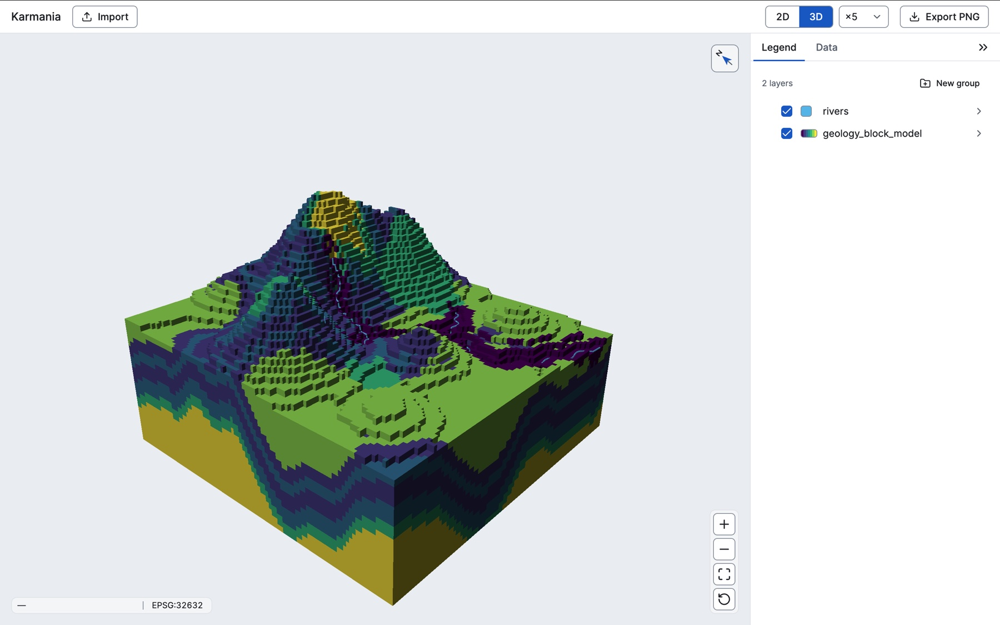
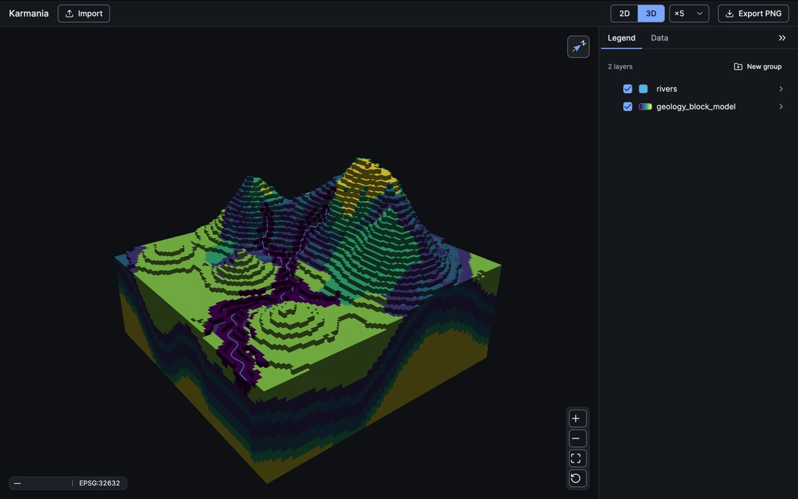
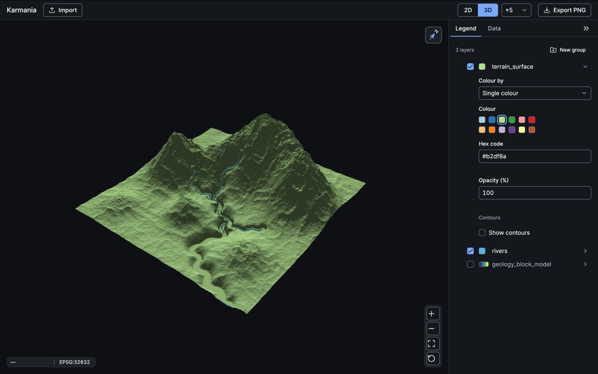
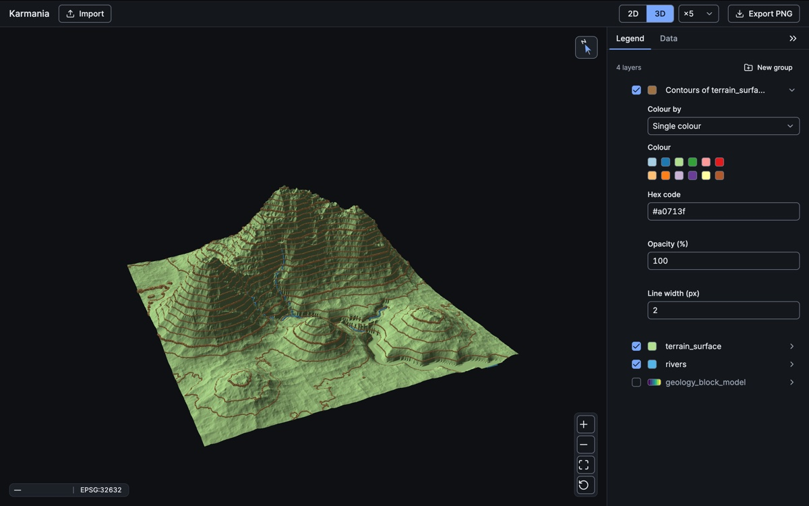
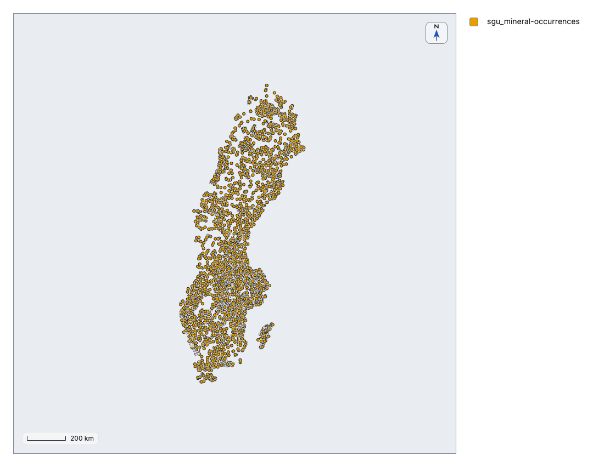

<h1 align="center">Karmania</h1>

<p align="center">
  <b>An open-source engine for geoscience map data.</b><br>
  Bring in points, lines, polygons, meshes, grids and block models, check them,<br>
  and draw them in 2D and 3D, with a legend, contours and PNG export.
</p>

<p align="center">
  <a href="LICENSE"></a>
  <a href="https://github.com/SupernovifieD/karmania-map-viewer/releases/latest"></a>
  <a href="https://github.com/SupernovifieD/karmania-map-viewer/actions/workflows/ci.yml"></a>
</p>

<p align="center">
  <a href="#what-it-looks-like"><b>What it looks like</b></a> ·
  <a href="#try-it-with-sample-data">Sample data</a> ·
  <a href="#setting-up">Setting up</a> ·
  <a href="docs/embedding.md">Embedding</a> ·
  <a href="CHANGELOG.md">Changelog</a>
</p>

<br>

<p align="center">
  
  <br>
  <sub>A synthetic geology block model (248,507 blocks) and its river in Karmania's 3D view, heights exaggerated five times.<br><i>Invented data: not a real place.</i></sub>
</p>

<br>

Karmania is an open-source engine for geoscience map data: a reusable core that other software can embed. It takes data in six standard shapes (points, lines, polygons, meshes, regular grids and block models), checks it, does a small amount of deterministic processing, and draws 2D and 3D maps with map furniture, which it can export as PNG images. It never invents values: every number it shows is either one it was given or a deterministic restatement of one (converted to another coordinate system, triangulated, contoured, or sorted into classes for display).

## What it looks like

The pictures are Karmania itself, in the browser (the toolbar on top with Import, 2D or 3D, the exaggeration of heights and Export PNG, then the map, and the panel with the Legend and the Data tab), and one of the pictures it exports.

<table>
  <tr>
    <td width="50%" valign="top">
      
      <br>
      <sub>The synthetic block model and its rivers, in the dark theme.</sub>
      <h3>Block models in 3D</h3>
      A block model is a volume of boxes, each with its own values. Here it is the rock of every block, six units from the ground down to −1,800 m. Karmania draws the volume in a perspective view that you can orbit, pan and zoom, and exaggerates the heights 2, 3, 5 or 10 times, so that a region 30 km wide whose ground rises about 2.4 km does not look flat. The layers are in the Legend, in an order you choose, and the interface comes in a light and a dark theme.
    </td>
    <td width="50%" valign="top">
      
      <br>
      <sub>The same region's terrain as a mesh of 80,000 triangles.</sub>
      <h3>Meshes: terrain and other surfaces</h3>
      A mesh is a surface of triangles, read from an OBJ file. Karmania draws it shaded by the light, in the colour you choose, and each layer has its own colour, opacity and settings in the Legend, as you see on the right of the picture. Heights are drawn as given and never converted, so what you see is what the file holds.
    </td>
  </tr>
  <tr>
    <td width="50%" valign="top">
      
      <br>
      <sub>Contour lines made by Karmania from the terrain mesh above.</sub>
      <h3>Contour lines, made from a mesh or a grid</h3>
      Contour lines are made from a grid (by a column) or from a mesh (by its heights), at an interval you choose. They become a dataset of their own: under their source in the Data tab, and in the Legend as a layer just above it, drawn over it, with its own colour, opacity and line width (brown and 2 px in the picture).
    </td>
    <td width="50%" valign="top">
      
      <br>
      <sub>Mineral occurrences of Sweden, as exported. Data: the Geological Survey of Sweden (SGU).</sub>
      <h3>Export a map as a picture</h3>
      <i>Export PNG</i> writes the map with its legend beside it, the north arrow and, in 2D, the scale bar, at a size you choose (the map as it is on screen, A4, A3 or your own) and at 96, 150 or 300 dpi, which is written into the file. This picture is such an export of a 2D map of points. A picture too large for the computer is refused, with the reason.
    </td>
  </tr>
</table>

<br>

## Try it with sample data

[**karmania-map-viewer-sample-datasets**](https://github.com/SupernovifieD/karmania-map-viewer-sample-datasets) is a repository of data to try in Karmania. Each sample is a folder with its files, a README that says what each file is and how to bring it in, and, for invented data, the script that made it. The first sample is **Synthetic mountains**, the data of most of the pictures above: a made-up region of 30 km by 30 km with a block model, rivers (lines), a terrain mesh and two grids, all in one coordinate system, 14 MB in all.

1. Run Karmania (see [Setting up](#setting-up); there is no hosted version yet).
2. Get the files of the sample: clone the sample repository, or download the files of its folder.
3. Press **Import** and choose a data file together with the `.prj` of the same name. The wizard suggests what each column is, and says what it found before anything is loaded.

## Where it stands

The work is in phases. **Phase 1, getting data in and checking it, is built and released as v0.1.0. Phase 2, drawing maps, is built and released as v0.2.0.** You can open the app, bring in files, see what was found in them, look at them on a map, and export the map as a picture.

What works today:

- **Import wizard.** Choose or drop files, and the wizard goes through five steps: File, Mapping (what each column is), Nodata (which values mean "no value"), CRS (the coordinate system) and Review. It previews the file first, runs the import with a progress bar, and says what it found before anything is loaded.
- **Findings.** Every problem, odd thing and note is a finding with a plain-language message, a hint about what to do, a count, and where it happened. Nothing is fixed silently: a skipped row or an assumed value is always reported. The full list is in [`docs/validation-codes.md`](docs/validation-codes.md).
- **Data tab.** The loaded datasets in a list, a summary of the selected one (kind, size, coordinate system with its name and unit, extent, columns, warnings, and why it is not drawn if it is not), and a table of its rows that stays quick with millions of rows and can be used with the keyboard.
- **Maps.** Points, lines, polygons, meshes, grids (each cell in its own colour, never blurred) and block models are drawn, in the map's coordinate system (the rules are below: a dataset that cannot be drawn in it stays loaded and says why). The 2D view looks straight down: you can pan, zoom and turn it, and nothing tilts. The 3D view is a perspective view you can orbit, pan and zoom, with the heights exaggerated 2, 3, 5 or 10 times if you want. The map has a north arrow (it turns with the map, and a click puts north up), a scale bar in 2D, zoom buttons, and the place under the pointer with the map's coordinate system. It needs a browser that gives the page WebGL 2.
- **Legend.** The layers, in an order you choose (the top of the list is drawn on top) and in groups, shown or hidden. A layer can be one colour, or coloured by a column in classes (equal intervals, quantiles, natural breaks, or categories) with a colour ramp you choose, and has its own opacity, point size or line width. Contour lines can be made from a grid (by a column) or a mesh (by its heights) and appear as a dataset of their own: under their source in the Data tab, and in the legend as a layer just above it, drawn over it. A layer that cannot be drawn says why.
- **Identify.** Click a feature to see its attributes; "Show in table" finds its row, and choosing a row of the table marks the feature on the map.
- **Export PNG.** The map with its legend beside it, the north arrow and, in 2D, the scale bar, at a size you choose (the map as it is on screen, A4, A3, or your own) and at 96, 150 or 300 dpi, which is written into the file. A picture too large for the computer is refused, with the reason.
- **Embedding.** The viewer can be put in another page. See [`docs/embedding.md`](docs/embedding.md).

## Coordinate systems and the map

Every dataset carries its coordinate system as a label: an EPSG code, or a local grid with its units. Karmania knows what the codes of the EPSG definitions mean (the name, whether the system is geographic or projected, and its unit): the import wizard finds a code by its number or its name, and the Data tab shows the name and unit with the code. For a geographic system it checks that the coordinates could be longitudes and latitudes, and says when X and Y look swapped, and it warns of a code it does not know. **It never changes the coordinates of a dataset:** it keeps what was given or chosen and says so.

A map is drawn in one coordinate system, the map's. These rules decide it, the same way every time:

- **The first dataset that can be drawn chooses.** If it is projected or a local grid, the map uses its system. If it is geographic (longitude and latitude), the map uses WGS 84 / UTM, in the zone of the centre of its extent (zone = floor((longitude + 180) / 6) + 1; EPSG:326xx north of the equator and 327xx south of it, with no special zones for Norway or Svalbard), and a note says which zone and why. The map keeps that system until you change it or the last dataset is removed.
- **You can change it.** The coordinate system on the bottom left of the map opens a dialog that lists which datasets would start or stop being drawn. A geographic system can be chosen too: it is drawn as plain longitude and latitude, with no scale bar.
- **Other datasets are converted to it before they are drawn**, in 64-bit numbers. Two EPSG systems are converted when the definitions allow it. Two local grids are taken to be the same grid (and scaled, for example from feet to metres: a note says so). A local grid and an EPSG system cannot be drawn together. A block model is drawn only in the map's own system. A grid in another system is drawn warped, so that its cells follow the system of the map.
- **Heights are never converted.** They are drawn as given.
- **Lines and the edges of polygons are straight between their converted corners.** Long edges are not divided up to follow the curve of the Earth.
- **A dataset that is not drawn stays loaded.** The Legend and the Data tab say why and what to do (usually: change the map's coordinate system).
- **The north arrow shows the north of the map's grid** (up on the screen at the start), not true north.

## Supported formats and their conventions

| What | Becomes | Notes |
| --- | --- | --- |
| CSV or other delimited text (comma, semicolon, tab or spaces) | Points, lines, or a block model | You say which column is X, Y and Z (the wizard suggests them from the header), and for lines which column says which line a row belongs to. |
| GeoJSON | Points, lines or polygons | A file with several kinds becomes one dataset for each. Properties become attribute columns. Polygon holes are kept. |
| ESRI ASCII grid (`.asc`) | A regular grid | The file lists the northern row first; the rows are turned so that the first is the southern one. A grid placed by its cell centres is moved to its corner. |
| OBJ | A triangle mesh | Faces with more than three corners are split into triangles. Normals and texture coordinates are ignored. |
| `.prj` (a projection file beside a data file with the same name) | The coordinate system | Read for an EPSG code. |

The rules that hold for all of them:

- **Text.** UTF-8 (with or without a byte order mark) and UTF-16 are read. Text that is neither is read as Windows-1252, with a warning. A semicolon-separated file may use a decimal comma.
- **No data.** Empty cells, `NA`, `N/A`, `null`, `NaN`, `-`, `*` and numbers such as `-999` or `-9999` can be marked as "no value" in the Nodata step. They become empty values, and are counted.
- **Coordinates are numbers in the file's own units.** In a CSV file, rows with an empty or unreadable coordinate either stop the import or are skipped with a count, as you choose; the other formats say what they leave out.
- **Numbering.** Anything shown to a person that numbers things starts at 1: lines of a file (the header is line 1), and the rows, lines, polygons, triangles and cells in the data table. Inside the engine everything starts at 0.
- **Limits.** A dataset can hold up to 134,217,728 elements. Very large GeoJSON files need a lot of memory, about twenty times their size (the memory in the browser was not measured).

The columns that say what each row is (X, Y and Z for points, `line #` for lines, `i` and `j` for grids, and so on) come first in the data table, then the columns from the file.

## Setting up

You need [Rust](https://rustup.rs) (the version is pinned in `rust-toolchain.toml`, and `rustup` installs it), Node (pinned in `.nvmrc`), pnpm (the version is in `package.json`), and [wasm-pack](https://github.com/drager/wasm-pack) (version 0.15.0: `cargo install wasm-pack --version 0.15.0`).

```
pnpm install
pnpm build:wasm                    # builds the Rust code for the browser into packages/engine/wasm (not committed)
pnpm --filter @karmania/app dev    # runs the app; open the address it prints
```

The component gallery, every component in every state, is at `/gallery.html` on the same address.

`scripts/build-wasm --dev` is a faster, unoptimised build for when you are changing Rust code. Use the default one for the browser tests and for anything you time: some of the tests import very large files, which the unoptimised build is too slow for.

`pnpm --filter @karmania/viewer build` makes the viewer as a library for another page to use: see [`docs/embedding.md`](docs/embedding.md).

## Testing

```
pnpm check        # formatting, lints, type checks, and every Rust and TypeScript unit test
pnpm test:e2e     # the browser tests; needs a browser: pnpm --filter @karmania/engine exec playwright install chromium
pnpm test:visual  # the screenshot tests, which need Docker running (see below)
pnpm test:axe     # an accessibility check of every screenshot state, in both themes, at two window sizes
pnpm perf         # how long the large files take, in a browser (writes them first)
```

Only Chromium is tested: the tests do not run in other browsers.

- `pnpm check` is what to run first, before a commit: most of its steps are the ones the continuous integration on GitHub runs, which also runs the browser and accessibility tests (run `pnpm test:e2e` too for a change to the page).
- The screenshot tests use the browser in the official Playwright Docker image, so the pictures are the same on every machine. Their reference pictures are not in git (they would make the repository large): `pnpm test:visual:update` takes them on a machine that has none, and `pnpm test:visual` then compares with them. Look at new pictures before relying on them. The continuous integration does not run them. The map itself has pictures of its own (a fixed 800 x 600 canvas, light and dark) for each kind of data, view and case.
- `pnpm perf` needs a quiet machine and a real graphics card. It uses three large files that `scripts/generate-fixtures` writes into `fixtures/generated/` (not committed): a million points, a grid of four million cells and a model of a million blocks. It measures the time to the first frame, the smoothness of panning, zooming, turning and orbiting, new classes, contour lines, switching between 2D and 3D, the export of a picture, and that the page is never held up for more than 50 ms. The maintainer keeps the results in `docs/perf.md` (not in git).
- A few timing tests for the Rust code only run when asked for, for example `cargo test -p karmania-prep --release --test timing -- --ignored --nocapture` (the other crates have theirs; see the tests' own comments).
- The browser tests are the Playwright projects `chromium` (`pnpm test:e2e`), `visual`, `accessibility` (`pnpm test:axe`), `performance` and `render-performance` (the last two are `pnpm perf`).

## How it is built

```
files ──► @karmania/app        the page: a toolbar and the viewer
              │
              ▼
          @karmania/viewer     the map area, the panel (Legend and Data tabs), the import wizard and the dialogs (Lit web components)
              │  uses            @karmania/ui has the components: tabs, dialog, table, ...
              │                  @karmania/scene has the scene of a map: layers, legend, cameras
              │                  @karmania/render draws it on a canvas (three.js, WebGL 2)
              ▼
          @karmania/engine     a TypeScript API that runs the Rust code in a Web Worker
              │  messages
              ▼
          karmania-wasm        the Rust code compiled to WebAssembly
              │
   ┌──────────┼───────────┬────────────┐
   ▼          ▼           ▼            ▼
karmania-io  karmania-core  karmania-crs  karmania-prep
readers      datasets,      coordinate    makes data ready
(CSV, ...)   tables,        systems:      to draw: converts,
             validation,    the EPSG      triangulates,
             findings       definitions,  classifies,
                            conversion    contours
```

- **`karmania-core`** is the heart: the six kinds of dataset, their tables of attributes, validation, and findings. It knows nothing about files, and about coordinate system codes only that 4326 is longitude and latitude: the rest of what a code means comes through a hook that `karmania-crs` fills in.
- **`karmania-io`** reads files into datasets, and turns what is wrong with them into findings. Large files are read in steps so the page stays alive.
- **`karmania-crs`** knows the EPSG coordinate systems (their names, kinds and units, and a search by code or name) and converts positions between them, and says in findings what it cannot convert.
- **`karmania-prep`** makes a dataset ready to draw: it chooses the map's coordinate system, converts positions into it, triangulates polygons, makes the buffers the graphics card draws, sorts values into classes, and makes contour lines. Everything heavy happens here, in the worker; the page only uploads what it is given and draws.
- **`karmania-wasm`** is the thin layer that lets the browser call the four.
- **`@karmania/engine`** starts a worker, sends it files and asks, and hands back datasets, summaries, pages of rows, drawing buffers, classes and contour lines. A file never blocks the page, and a table asks only for the rows in view.
- **`@karmania/ui`** is the set of components and the design tokens (colours, sizes, light and dark themes). The app is built from them.
- **`@karmania/scene`** is the scene of a map and what is worked out from it: the layers and their styles, the legend, the cameras, the colour ramps, the north arrow and the scale bar, and the layout of an exported picture. It has no DOM and draws nothing.
- **`@karmania/render`** draws the layers of a scene on a canvas with three.js and WebGL 2, in 2D and 3D: points, lines, polygons, meshes, grids and blocks, coloured by one colour or by classes, from the buffers that the engine makes. It picks what is under the pointer, and makes the picture for an export. It has no interface of its own.
- **`@karmania/viewer`** is the viewer a page embeds: the map area, the side panel with the Legend and Data tabs, the import wizard and the dialogs for the map's coordinate system and for export, as the element `<karmania-viewer>` and the function `createViewer`.
- **`@karmania/app`** is the page itself: a toolbar (Import, 2D or 3D, the exaggeration of heights, Export PNG) over the viewer, and the gallery of the components.

A few principles run through all of it: data problems are findings and never crashes; output is the same every time for the same input; the map is drawn only when something changes, and what it uses on the graphics card is freed; and the interface is checked by tests that look at the page, at three window sizes from 1024 x 640 up, in both the light and the dark theme.

## Where to look next

| | |
| --- | --- |
| [`docs/validation-codes.md`](docs/validation-codes.md) | Every finding: its message, its hint, and an example. |
| [`docs/embedding.md`](docs/embedding.md) | How to put the viewer in another page: the files, `createViewer`, loading data, exporting a picture, and the content security policy it needs. |
| [`docs/design-tokens.md`](docs/design-tokens.md) | The colours, sizes and spacing the interface is made from. |
| [`docs/dependencies.md`](docs/dependencies.md) | What it depends on, and the licence of each. |
| [`THIRD_PARTY_NOTICES.md`](THIRD_PARTY_NOTICES.md) | The code and data that Karmania includes, with their licences and the notice for the EPSG data. |
| [`CHANGELOG.md`](CHANGELOG.md) | What each release has. |

## Licence

Apache 2.0. See `LICENSE`. The code and data that Karmania includes have licences of their own, listed in `THIRD_PARTY_NOTICES.md`.
